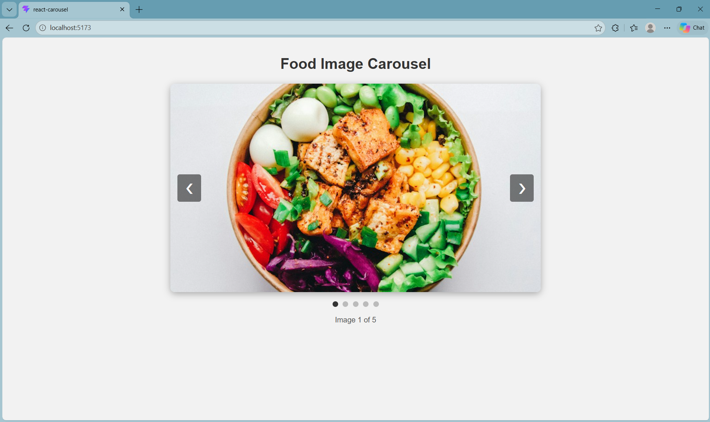
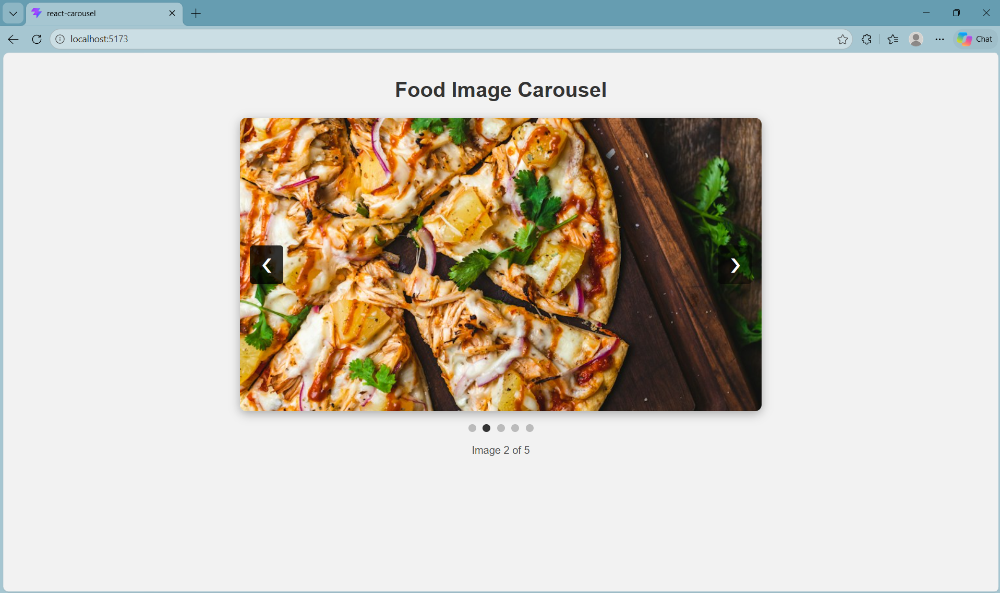
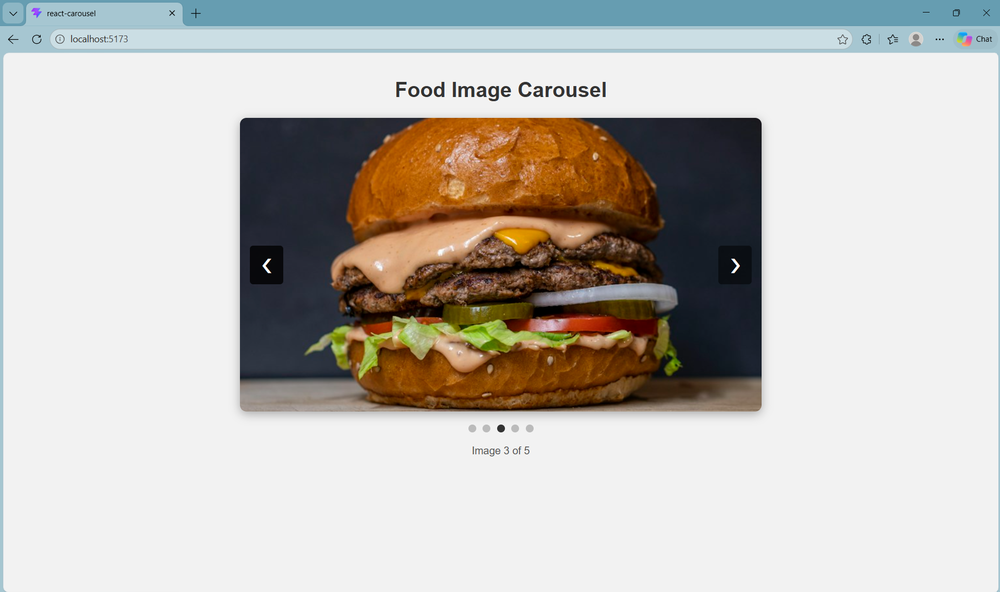
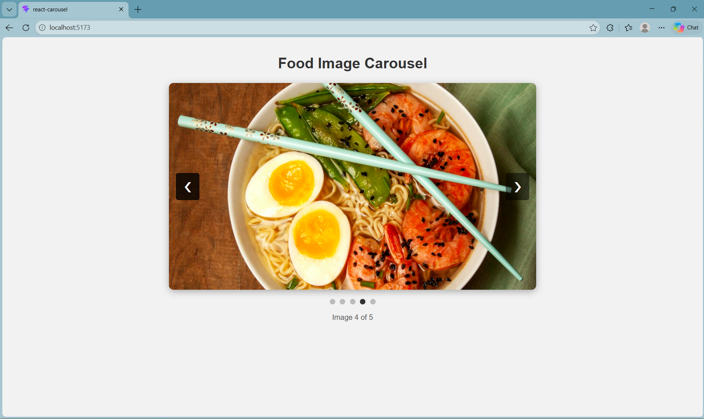
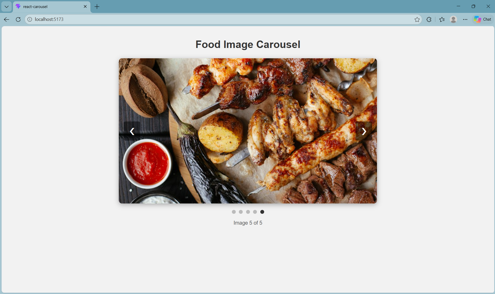

# Ex05 Image Carousel
## Date:

## AIM
To create a Image Carousel using React 

## ALGORITHM
### STEP 1 Initial Setup:
Input: A list of images to display in the carousel.

Output: A component displaying the images with navigation controls (e.g., next/previous buttons).

### Step 2 State Management:
Use a state variable (currentIndex) to track the index of the current image displayed.

The carousel starts with the first image, so initialize currentIndex to 0.

### Step 3 Navigation Controls:
Next Image: When the "Next" button is clicked, increment currentIndex.

If currentIndex is at the end of the image list (last image), loop back to the first image using modulo:
currentIndex = (currentIndex + 1) % images.length;

Previous Image: When the "Previous" button is clicked, decrement currentIndex.

If currentIndex is at the beginning (first image), loop back to the last image:
currentIndex = (currentIndex - 1 + images.length) % images.length;

### Step 4 Displaying the Image:
The currentIndex determines which image is displayed.

Using the currentIndex, display the corresponding image from the images list.

### Step 5 Auto-Rotation:
Set an interval to automatically change the image after a set amount of time (e.g., 3 seconds).

Use setInterval to call the nextImage() function at regular intervals.

Clean up the interval when the component unmounts using clearInterval to prevent memory leaks.

## PROGRAM


### App.css

```App.css

* {
  margin: 0;
  padding: 0;
  box-sizing: border-box;
}

body {
  font-family: Arial, sans-serif;
  background-color: #f2f2f2;
}

.container {
  text-align: center;
  padding-top: 40px;
}

h1 {
  margin-bottom: 25px;
  color: #333;
}

.carousel {
  position: relative;
  width: 800px;
  max-width: 90%;
  margin: auto;
  overflow: hidden;
  border-radius: 10px;
  box-shadow: 0 4px 15px rgba(0, 0, 0, 0.3);
}

.carousel img {
  width: 100%;
  height: 450px;
  object-fit: cover;
  display: block;
}

button {
  position: absolute;
  top: 50%;
  transform: translateY(-50%);
  border: none;
  background-color: rgba(0, 0, 0, 0.5);
  color: white;
  font-size: 30px;
  padding: 10px 18px;
  cursor: pointer;
  border-radius: 5px;
}

button:hover {
  background-color: rgba(0, 0, 0, 0.8);
}

.previous {
  left: 15px;
}

.next {
  right: 15px;
}

.dots {
  margin-top: 15px;
}

.dot {
  display: inline-block;
  width: 12px;
  height: 12px;
  margin: 5px;
  background-color: #bbb;
  border-radius: 50%;
  cursor: pointer;
}

.dot.active {
  background-color: #333;
}

p {
  margin-top: 10px;
  font-size: 16px;
  color: #555;
}

```

### App.jsx


```App.jsx

import React, { useState, useEffect } from "react";
import "./App.css";

function App() {

  const images = [
    "https://images.unsplash.com/photo-1546069901-ba9599a7e63c?w=800",
    "https://images.unsplash.com/photo-1565299624946-b28f40a0ae38?w=800",
    "https://images.unsplash.com/photo-1568901346375-23c9450c58cd?w=800",
    "https://images.unsplash.com/photo-1569718212165-3a8278d5f624?w=800",
    "https://images.unsplash.com/photo-1555939594-58d7cb561ad1?w=800"
  ];

  const [currentIndex, setCurrentIndex] = useState(0);

  const nextImage = () => {
    setCurrentIndex(
      (currentIndex + 1) % images.length
    );
  };

  const previousImage = () => {
    setCurrentIndex(
      (currentIndex - 1 + images.length) % images.length
    );
  };

  useEffect(() => {
    const interval = setInterval(() => {
      setCurrentIndex(
        (currentIndex) => (currentIndex + 1) % images.length
      );
    }, 3000);

    return () => clearInterval(interval);
  }, []);

  return (
    <div className="container">

      <h1>Food Image Carousel</h1>

      <div className="carousel">

        

        <button
          className="previous"
          onClick={previousImage}
        >
          ❮
        </button>

        <button
          className="next"
          onClick={nextImage}
        >
          ❯
        </button>

      </div>

      <div className="dots">
        {images.map((_, index) => (
          <span
            key={index}
            className={
              index === currentIndex
                ? "dot active"
                : "dot"
            }
            onClick={() => setCurrentIndex(index)}
          ></span>
        ))}
      </div>

      <p>
        Image {currentIndex + 1} of {images.length}
      </p>

    </div>
  );
}

export default App;


```

### index.css

```index.css

* {
  box-sizing: border-box;
}

body {
  margin: 0;
}

#root {
  width: 100%;
  min-height: 100vh;
}


```

### main.jsx

```main.jsx
import { StrictMode } from 'react'
import { createRoot } from 'react-dom/client'
import './index.css'
import App from './App.jsx'

createRoot(document.getElementById('root')).render(
  <StrictMode>
    <App />
  </StrictMode>,
)

```


## OUTPUT












## RESULT
The program for creating Image Carousel using React is executed successfully.